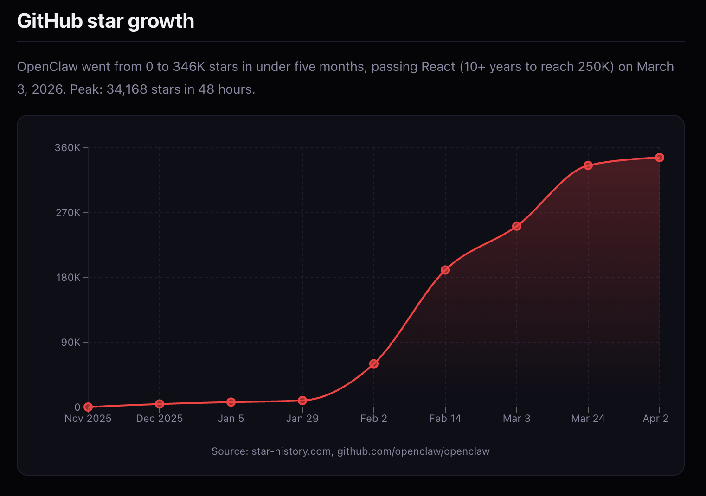
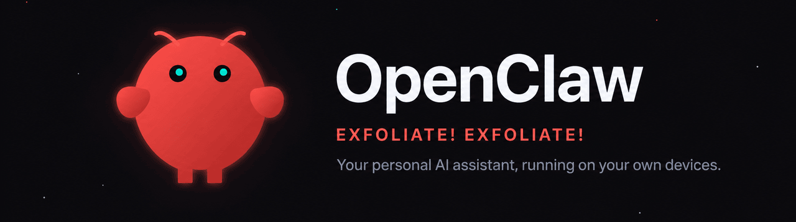
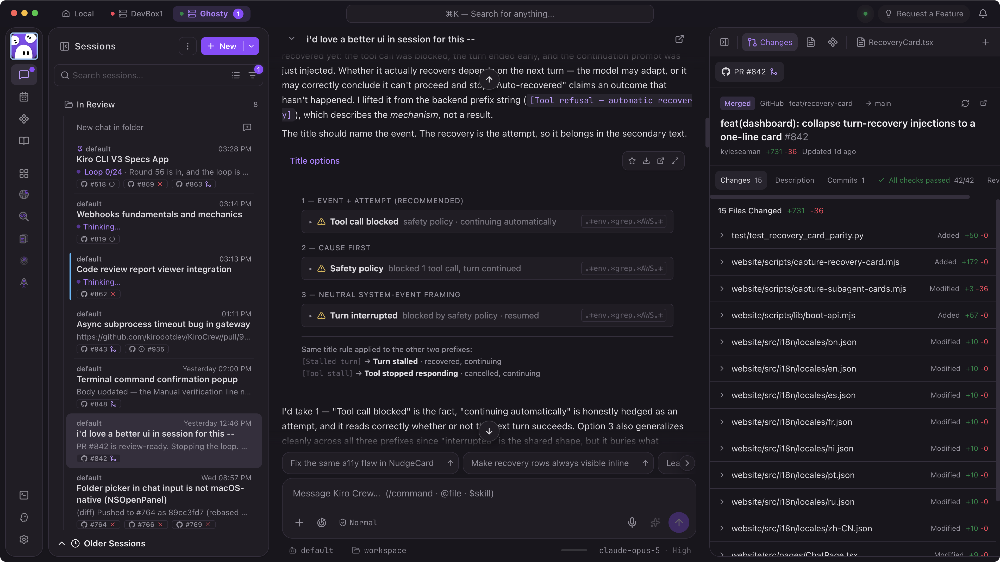

  <AwsOpenSourceLogo tone="dark" class="cover-logo" />
  
AWS COMMUNITY DAY CURITIBA · SEP 19, 2026

  <h1 class="cover-title-long">Open Source como Base para a Era da IA: da Infraestrutura Essencial às Aplicações Agênticas</h1>
  <PresenterIdentity class="cover-presenter" />
  
TRUSTINFRASTRUCTUREAICONTRIBUTION

<!--
Boa tarde, Curitiba! Tudo bem?

I am from Mexico, so before anything else, let me say the one thing that will make us friends for the next forty minutes: Pelé is the greatest football player in history. Good. Now we can talk about anything.

It’s the end of a long day, you’ve had a lot of coffee, and I’m the last thing standing between you and the after-party. So let me make it worth your time.

My name is Roberto Luna Rojas. I’m a Sr Open Source Developer Advocate at AWS. I work on the Valkey open source project, and I’m passionate about databases and distributed systems. I grew up in a small town in Mexico, and open source helped me become a global speaker.

This is not a product keynote. It’s a rally for the open source stack beneath AI, and for the people in this room who can help build it.

***

- Open in Portuguese and wait for the room to answer before switching to English.
- Let the Pelé line land; it is the icebreaker, so give the reaction a beat before the after-party joke.
- Time check: 0:45.
-->

---
layout: default
class: career-door-slide
routeAlias: career-door
clicks: 3
---

  
THE DOOR OPEN SOURCE OPENED

  <h1>My résumé said less than my commits did.</h1>
  
Public work gave people evidence they could inspect, not a promise they had to trust.

  <article v-click.fade.right="1">2017<strong>Started contributing</strong>
Small Redis fixes in my spare time. Useful work, in public, with my name on it.
</article>
  
→

  <article v-click.fade.right="2">NEXT<strong>Promoted to Staff</strong>
The work was portable proof of how I thought, collaborated, and shipped.
</article>
  
→

  <article v-click.fade.right="3">2020<strong>Joined AWS</strong>
No perfect résumé. No special connection. Commits anyone could read.
</article>

<SlideFooter />

<!--
I want to start with something personal. My open source journey started back in 2000. For a long time I was mainly a supporter, not a contributor. I made a living helping customers move away from commercial, closed-source software to open source alternatives. I was a developer like many of you in this room. No special title, no platform, no audience. What I had was access to open source. I could read the code that ran the internet, and I could change it.

[click] Then, in 2017, I stopped only supporting and started contributing. Small fixes to Redis in my spare time. Nothing dramatic at first, just fixing things I ran into, improving what I used every day. But that work was public, and it had my name on it.

[click] People noticed. That open source work got me promoted to Staff engineer. It was portable proof of how I thought, how I collaborated, and how I shipped.

[click] And in 2020, it opened the door to a job here at AWS. I did not have a connection or a perfect résumé. I had commits anyone could read. That is the door open source opened for me, and it’s the same door I want to open for every one of you today.

***

- The 2000 supporter era is spoken before the first click; the timeline on the slide starts at 2017, when the contributions began.
- Deliver plainly. This is the real anecdote; do not inflate the causal claim beyond lived experience.
- Time check: 3:00.
-->

---
layout: center
class: statement-slide statement-slide--dark
routeAlias: not-magic
---

  
THE MODELS GET THE HEADLINES

  <h1>A IA não roda em mágica. Roda em código aberto.</h1>
  
AI does not run on magic. It runs on open source.

<!--
So when everyone tells you the AI revolution is about the models, I want to offer a different view. The models get the headlines. But they don’t run on magic.

A IA não roda em mágica. Roda em código aberto.

They run on open source. And here’s the part that matters for every single person in this room: that open source is built by people. Not just companies. People who decided to show up and contribute.

***

- Say the Portuguese line slowly and pause before the English.
- Time check: 4:15.
-->

---
layout: default
class: promise-slide
routeAlias: promise
clicks: 3
---

  
THE PROMISE

  <h1>There is a place in this stack for you.</h1>

  <article v-click.fade.right="1">01<strong>See the whole stack</strong>
From Linux to agents, not only the model at the top.
</article>
  <article v-click.fade.right="2">02<strong>See how it works</strong>
Trust, data, inference, memory, retrieval, and durable state.
</article>
  <article v-click.fade.right="3">03<strong>Find your on-ramp</strong>
One project. One small contribution. One first pull request.
</article>

<SlideFooter />

<!--
The future of AI is being written right now, in the open, and there is a place in it for you. So here is my promise.

[click] You’ll see the whole stack that AI is built on. From Linux all the way up to agents, not only the model at the top.

[click] You’ll understand how the layers work together: trust, data, inference, memory, retrieval, and durable state.

[click] And you’ll know exactly where you can jump in. One project, one small contribution, one first pull request. Whatever you love, there’s a layer for you.

***

- State the invitation early; the three asks at the close pay off these three promises.
- Time check: 5:00.
-->

---
layout: default
class: trust-anchor-slide
routeAlias: trust-anchor
clicks: 3
---

  
WHY OPEN · THE TRUST ANCHOR

  <h1>You trust the lock because the lock can be inspected.</h1>

  <article v-click.fade.right="1">TLS<strong>Your bank login</strong>
A security boundary you depend on every day.
</article>
  
runs through

  <article v-click.fade.right="2">OPENSSL<strong>Open and auditable</strong>
Researchers, maintainers, and operators can inspect the implementation.
</article>
  
2014

  <article class="trust-alert" v-click.fade.right="3">HEARTBLEED<strong>Visible. Fixable. Shared.</strong>
Openness did not prevent the flaw; it made coordinated scrutiny and repair possible.
</article>

Não confiaríamos no TLS se o OpenSSL fosse fechado.

Reference: heartbleed.com · openssl.org/news/secadv/20140407.txt

<SlideFooter />

<!--
Before I show you the stack, I want to answer a question you should be asking: why does any of this need to be open source at all? The models work whether I can see them or not. Right?

Here’s why it matters.

[click] Think about TLS, the lock icon in your browser, the thing that encrypts your bank login. You trust it every day.

[click] And the reason you can trust it is OpenSSL, the open source library that does the encrypting. Anyone can read it. Anyone can audit it.

[click] When Heartbleed, a serious bug, was found in 2014, the whole world could see it. Openness did not make OpenSSL perfect. But it made the problem visible, and it let researchers, maintainers, and operators coordinate the fix and share it. Now imagine OpenSSL had been a closed black box owned by one company. Would you trust it with your bank password on nothing but their word? Of course not.

Não confiaríamos no TLS se o OpenSSL fosse fechado.

We wouldn’t trust TLS if OpenSSL were closed. So why would we accept a black box making consequential AI decisions?

***

- Pause after the Portuguese line.
- Keep Heartbleed at visibility and shared remediation; do not say “fixed fast because open” as a universal law.
- Reference: heartbleed.com and openssl.org/news/secadv/20140407.txt.
- Time check: 7:00.
-->

---
layout: default
class: openness-slide
routeAlias: three-kinds-of-open
clicks: 3
---

  
TRUST NEEDS MORE THAN A PROMISE

  <h1>Open the system at three different boundaries.</h1>

  <article v-click.fade.right="1">OPEN CODE<strong>See how it works.</strong>
Inspect orchestration, safety controls, retrieval, memory, and application logic.
</article>
  <article v-click.fade.right="2">OPEN WEIGHTS<strong>Run and inspect it.</strong>
Evaluate the model yourself instead of renting an unexplained mystery.
</article>
  <article class="openness-caveat" v-click.fade.right="3">OPEN DATA · WHERE POSSIBLE<strong>Ask what it learned.</strong>
Licensing, privacy, and scale make this the hardest boundary. Direction, not a solved problem.
</article>

Só podemos confiar na IA se ela for aberta.

<SlideFooter />

<!--
AI is making decisions now. Who gets a loan. What medical information you see. What your kids read. If we can’t inspect it, we’re trusting it on a vendor’s promise. And trust on a promise is not trust, it’s hope.

Real trust in AI comes from three things being open.

[click] Open source code, so you can see how the system works: the orchestration, the safety controls, the retrieval, the memory, the application logic around the model.

[click] Open-weight models, so you can inspect, evaluate, and run the model yourself instead of renting a mystery.

[click] And open data, where possible, so you can ask what the model actually learned from. I’ll be honest with you about that last one. Fully open training data is the hardest part. Licensing, privacy, and scale make it genuinely difficult, and a lot of great open-weight models are not fully open-data. So I’m not going to stand here and pretend it’s solved. But the direction is what matters: the more open the code, the weights, and the data, the more we can audit, reproduce, and actually trust what these systems do.

Só podemos confiar na IA se ela for aberta.

We can only trust AI if it’s open. That’s not idealism. It’s the same lesson OpenSSL already taught us.

***

- Pause after the Portuguese line.
- This is a direction and an accountability standard, not a claim that openness alone guarantees safety.
- Time check: 9:30.
-->

---
layout: default
class: audit-loop-slide valkey-indigo
routeAlias: open-loop
clicks: 3
---

  
THE OPEN SOURCE LOOP

  <h1>Openness turns flaws into shared work.</h1>

  <article v-click.fade.right="1">01<strong>SEE</strong>
Independent people can inspect what the system actually does.
</article>
  
→

  <article v-click.fade.right="2">02<strong>FIX</strong>
Maintainers and users can collaborate on a concrete patch.
</article>
  
→

  <article v-click.fade.right="3">03<strong>IMPROVE</strong>
The repair becomes reusable knowledge for everyone downstream.
</article>

A closed black box asks you to hope the owner noticed.

<SlideFooter tone="dark" />

<!--
And openness doesn’t just let us audit. It lets us fix, together. Openness does not eliminate flaws. It changes who can see them, who can help repair them, and who benefits from the repair.

[click] See. Independent people can inspect what the system actually does.

[click] Fix. A problem becomes a reproducible issue and a reviewable patch, and maintainers and users work on it together.

[click] Improve. The repair becomes reusable knowledge for everyone downstream.

That is the open source loop working exactly as it should: something imperfect gets built in the open, and everyone makes it better. A closed black box gives you none of that. You just have to hope the owner noticed.

***

- The OpenClaw and KiroCrew examples follow on the next two slides; this slide sets up the loop they illustrate.
- Time check: 10:30.
-->

---
layout: default
class: openclaw-slide valkey-dark
routeAlias: openclaw
clicks: 3
---

  
THE LOOP IN PRACTICE · VIRAL OPEN SOURCE

  <h1>Not perfect. But it started a conversation.</h1>

  
  

    
    

      <article v-click.fade.right="1">01 · VIRAL<strong>0 to 346K stars in under five months.</strong>
Passed React on March 3, 2026. Peak: 34,168 stars in 48 hours.
</article>
      <article v-click.fade.right="2">02 · IMPERFECT, IN PUBLIC<strong>Real security flaws, found in the open.</strong>
Open code meant the community could see them, report them, and fix them together.
</article>
      <article v-click.fade.right="3">03 · THE DOOR<strong>The creator joined OpenAI.</strong>
Peter Steinberger, February 2026. The project lives on in a foundation.
</article>
    

  

Sources: github.com/openclaw/openclaw · star-history.com · TechCrunch, February 15, 2026

<SlideFooter tone="dark" />

<!--
Let me show you this loop in practice, with a project most of you saw on your feeds this year.

OpenClaw. An open source personal AI assistant that runs on your own devices. Started by one developer, Peter Steinberger, at the end of 2025.

[click] It went viral almost overnight. Zero to three hundred and forty-six thousand GitHub stars in under five months. It passed React, which took more than ten years to reach two hundred and fifty thousand.

[click] And it was not perfect. It had real security flaws. But because the code was open, the community could see those flaws, report them, and work on them together. That is the loop from the last slide, running in public.

[click] And here is the door part of the story. In February 2026, the creator of OpenClaw joined OpenAI, and the project moved into a foundation so it keeps living as open source. One person, one repository, in the open.

It was not perfect. It started a conversation. That is what open source does.

***

- The numbers are on the chart with their source; star counts keep growing, so do not quote today’s total unless you checked it that morning.
- Keep the security point factual: flaws were found and fixed in the open. Do not name specific CVEs unless you have verified them.
- Sources: github.com/openclaw/openclaw, star-history.com, TechCrunch (February 15, 2026).
- Time check: 11:45.
-->

---
layout: default
class: kirocrew-slide valkey-dark
routeAlias: kirocrew
---

  

    
THE LOOP, CLOSED · SECURITY FIRST · BUILT INSIDE AWS, OPENED TO THE WORLD

    <h1>KiroCrew: the same idea, rebuilt security first.</h1>
  

  <a class="kirocrew-link" href="https://github.com/kirodotdev/KiroCrew">github.com/kirodotdev/KiroCrew</a>

<!--
And the conversation did not stop at OpenClaw.

Inside AWS, that same openness let us build our own take on the idea: KiroCrew. A security-first version of OpenClaw, built internally first, and then opened to the world on GitHub.

What you see here is a real KiroCrew session: an agent working through a pull request, with every change, every check, and the merge visible. Security first means that when the safety policy blocks a tool call, the session tells you, right there.

Something imperfect got built in the open. Someone else made it better, in the open. Everyone downstream benefits. That is the loop, closed.

***

- This is the speaker’s own framing of KiroCrew as a security-first take on OpenClaw; keep it to that framing unless you can cite a public statement.
- github.com/kirodotdev/KiroCrew, Apache-2.0, kiro.dev/crew.
- Time check: 12:45.
-->

---
layout: default
class: valkey-profile-slide
routeAlias: what-is-valkey
clicks: 3
---

  
MY HOME IN THE STACK · WHAT IS VALKEY

  <h1>Valkey: open source, high performance, forever.</h1>

<ValkeyProfile :step="$clicks" />

<kbd>→</kbd> workloads, backing, community

<SlideFooter />

<!--
One more stop before the whole stack. Let me introduce my home in it. What is Valkey?

[click] Valkey is an open source, high-performance key/value datastore. It handles caching, the classic workload. It handles message queues. And it can act as a primary database.

[click] It is BSD licensed, and the project is backed by the Linux Foundation, which means it will remain open source forever. Nobody can change that license on you.

[click] And here is the community part. In March 2024, Redis changed its license. Eight days later, the community launched Valkey: vendor neutral, under the Linux Foundation. Today the Technical Steering Committee has maintainers from AWS, Google Cloud, Oracle, Alibaba, Tencent, Ericsson, Percona, and Apple®. Eight companies, one project, no single owner.

***

- The icons carry the description; name the workloads instead of reading the tiles.
- The panel shows the seven permitted TSC affiliation logos from MAINTAINERS.md in github.com/valkey-io/valkey; Apple® is rendered as plain text because this presentation does not have permission to use the Apple logo.
- Dates: Redis relicensed on March 20, 2024; the Linux Foundation announced Valkey on March 28, 2024.
- Time check: 14:15.
-->

---
layout: center
class: statement-slide statement-slide--dark community-slide
routeAlias: community
---

  
WHY PROJECTS OUTLIVE LICENSES

  <h1>Você vem pelo software. Você fica pela comunidade.</h1>
  
You come for the software. You stay for the community.

<!--
That is what those eight days taught me.

Você vem pelo software. Você fica pela comunidade.

You come for the software. You stay for the community. The code brought all of us to Valkey. The people are why we are still there.

***

- Pause after the Portuguese line before translating.
- Time check: 14:45.
-->

---
layout: default
class: pyramid-slide
routeAlias: open-source-stack
clicks: 4
---

  
THE FOUNDATION OF THE AI ERA

  <h1>The model is the smallest layer of the story.</h1>

<OpenSourcePyramid :step="$clicks" />

<kbd>→</kbd> build the stack from the ground up

<SlideFooter />

<!--
Let me show you what I mean by “the whole stack.” This is the pyramid that every AI application stands on. Let’s walk it from the bottom up, because the bottom is where it all starts.

[click] At the foundation: Linux. The operating system running essentially every server, every container, every cloud instance your AI touches. None of this exists without it.

[click] One layer up: Kubernetes. It schedules and scales all those containers. When your AI app needs to grow from one user to a million, this is the layer that makes it possible.

[click] Above that, the data layer, and this is where state lives. Valkey holds the fast memory and the vectors. OpenSearch handles search and retrieval at scale. PostgreSQL holds the durable, relational truth. Memory, vectors, search, durable state: the things every application needs to remember anything.

[click] And at the top, the AI layer. PyTorch to train the models. vLLM to serve them, to run inference fast and cheap. And Strands to build agents, AWS’s open source SDK for turning a model into something that can reason and act.

Here’s the point I want you to hold onto. Every single layer of this pyramid is open source. Top to bottom. There is no proprietary secret holding it up.

***

- Do not rush the reveal. The pyramid is the recurring spine of the talk and returns on the on-ramp slides.
- Time check: 18:45.
-->

---
layout: center
class: statement-slide statement-slide--light
routeAlias: already-open
---

  

    <BrandLogo compact tone="light" />
  

  <h1>Se você constrói para a nuvem, você já constrói sobre código aberto.</h1>
  
If you build for the cloud, you already build on open source.

<!--
Se você constrói para a nuvem, você já constrói sobre código aberto.

If you build for the cloud, you already build on open source. You just might not have noticed how much.

***

- Pause after the Portuguese line.
- The point is agency, not guilt.
- Time check: 20:15.
-->

---
layout: default
class: prompts-slide
routeAlias: semantic-intuition
clicks: 4
---

  
SAME INTENT · DIFFERENT WORDS

  <h1>An exact-key cache sees strings. A semantic cache sees meaning.</h1>

  

    
“How do I reset my password?”

    
“I forgot my password. What now?”

    
“Password reset steps, please.”

  

  
→

  
ONE STABLE INTENT<strong>Answer once.</strong>
Serve near-matches only when context and distance say the answer is safe to reuse.

<SlideFooter />

<!--
A pyramid is nice, but let me show you these layers actually working together, because that’s where it gets exciting, and where the economics of AI get decided.

Think about an FAQ or support bot. Thousands of users ask the same two hundred questions, just worded differently.

[click] “How do I reset my password?”

[click] “I forgot my password. What now?”

[click] “Password reset steps, please.”

[click] Same question. Same answer. An exact-key cache sees three different strings. A semantic cache sees one intent. Answer it once, and serve everyone else near-instantly, as long as the context and the distance say the answer is safe to reuse.

Second example: a recommendation system. Similar users, in similar contexts, get similar recommendations. Instead of recomputing the whole thing every time, you reuse the result for the near-matches. Same pattern, different shape.

***

- Read each prompt aloud as it appears, so the audience hears the equivalence before you explain embeddings.
- Time check: 22:00.
-->

---
layout: default
class: semantic-flow-slide
routeAlias: semantic-cache
clicks: 5
---

  
SEMANTIC CACHE · REQUEST TRACE

  <h1>The nearest safe answer becomes the fast path.</h1>

<SemanticCacheDiagram :step="$clicks" />

<kbd>→</kbd> advance the semantic trace

<SlideFooter />

<!--
Here’s how it works. When a question comes in, you don’t call the expensive model right away.

[click] First you turn the question into a vector, an embedding, a representation of its meaning.

[click] Then you ask the data layer: have I seen anything like this before? That lookup runs on Valkey Search, against the cached prompt vectors.

[click] If there’s a match within the distance threshold, and the context is compatible, you serve the answer you already computed. Milliseconds. No model call, no token cost. That’s a cache hit.

[click] If it’s a genuinely new question, that’s a miss. You call the model once.

[click] Then you store the embedding and the answer, with a TTL, so the next person who asks something close gets it for free.

One honest note. The embedding call still costs something. What you avoid is the much larger generation call. And similarity is a guardrail, not proof of correctness, which is why the threshold matters.

***

- Walk the trace; do not read every label on the diagram.
- Time check: 23:45.
-->

---
layout: default
class: benchmark-slide valkey-indigo
routeAlias: benchmark
clicks: 3
---

  
ONE AWS EVALUATION · NOT A GUARANTEE

  <h1>On repetitive workloads, avoided calls change the economics.</h1>

  <article class="benchmark-card" v-click.fade.right="1">LLM COST SAVINGS<strong>86.3%</strong>
At a 0.75 similarity threshold.
</article>
  <article class="benchmark-card" v-click.fade.right="2">LATENCY REDUCTION<strong>88.3%</strong>
Average end-to-end latency.
</article>
  <article class="benchmark-card" v-click.fade.right="3">CACHED-ANSWER ACCURACY<strong>91.2%</strong>
The guardrail beside the savings.
</article>

63,796 QUERIESTITAN TEXT EMBEDDINGS V2CLAUDE 3 HAIKUCACHE.R7G.LARGE

Cache semântico pode cortar até 86% do custo de inferência.

Source: AWS Database Blog, “Lower cost and latency for AI using Amazon ElastiCache as a semantic cache with Amazon Bedrock.” Results vary by model, data, threshold, and cache.

<SlideFooter tone="dark" />

<!--
And the savings are real. This is one evaluation AWS published: about sixty-four thousand real chatbot queries, Titan Text Embeddings, Claude 3 Haiku, and one ElastiCache instance as the semantic cache.

[click] At a 0.75 similarity threshold, LLM cost dropped 86.3 percent.

[click] Average end-to-end latency dropped 88.3 percent.

[click] And the guardrail beside those numbers: 91.2 percent of the cached answers were correct for the user’s intent. That accuracy tradeoff belongs right next to the savings, not in the fine print.

Cache semântico pode cortar até 86% do custo de inferência.

Semantic caching can cut up to 86 percent of your inference cost. That’s not a rounding error. That’s the difference between an AI feature you can afford to ship and one you can’t.

***

- Emphasize “pode” and “até”. This is one evaluation, not a universal promise; results vary by model, data, threshold, and cache.
- Source: AWS Database Blog, “Lower cost and latency for AI using Amazon ElastiCache as a semantic cache with Amazon Bedrock” (63,796 queries, cache.r7g.large).
- Time check: 25:15.
-->

---
layout: default
class: agent-path-slide
routeAlias: agentic-path
clicks: 5
---

  
THE AGENTIC DATA PATH

  <h1>An agent is a model surrounded by open source primitives.</h1>

<AgenticDataPath :step="$clicks" />

<kbd>→</kbd> trace the support agent’s tools

<SlideFooter />

<!--
Now let me show you the whole picture of a modern agent. In the middle is a Strands agent, a support assistant. Around it are the open source primitives it leans on, every one of them from that pyramid.

[click] Semantic cache on Valkey, so it doesn’t pay twice. Have we already answered this intent?

[click] Conversation memory on Valkey, so it remembers what you said a turn ago.

[click] Retrieval, the R in RAG, on Valkey and OpenSearch together: vectors plus full-text search to find the right knowledge.

[click] Inference on vLLM, fast model serving, and only when a new answer is actually needed.

[click] And durable state on PostgreSQL, the source of truth: tickets, policy, and outcomes that must persist.

That’s the whole picture. Strands writes the agent loop. The open source data layer makes it useful, fast, and affordable.

***

- vLLM can integrate with external KV-cache systems, but keep the spoken claim at “fast model serving” unless you have a verified reference to cite.
- Time check: 26:45.
-->

---
layout: default
class: two-bills-slide
routeAlias: two-bills
clicks: 2
---

  
TWO DIFFERENT BILLS · ONE REUSE PATTERN

  <h1>Open source makes expensive repetition optional.</h1>

  <article v-click.fade.right="1">AI INFERENCE<strong>up to 86%</strong>
Lower inference cost in the cited semantic-cache evaluation.
<small>reuse a safe answer</small></article>
  <article v-click.fade.right="2">DATABASE ACCESS<strong>up to 55%</strong>
Potential savings for frequently accessed data when cache hit rate enables right-sizing.
<small>reuse hot data</small></article>

Different workloads. Different evidence. Same idea: do the expensive thing once.

Do not combine these percentages. Benchmark the eligible workload, correctness, hit rate, latency, and total cost before making a capacity decision.

<SlideFooter />

<!--
One more honest word on cost, because these are two different bills.

[click] The 86 percent I mentioned is inference. It comes from the semantic-caching evaluation I just showed you.

[click] Separately, putting an open source cache in front of your database can cut database cost by up to 55 percent for frequently accessed data, when the hit rate is high enough to right-size the database underneath.

Two different bills, one pattern: open source takes the expensive thing and makes it cheap. And every dollar you save on infrastructure is a dollar you can spend on innovation. Just measure first. Benchmark your workload, check correctness, then make the capacity decision.

***

- Never combine the two percentages; they describe different workloads and different evidence.
- Time check: 27:45.
-->

---
layout: default
class: career-value-slide
routeAlias: career-value
clicks: 3
---

  
WHAT THIS MEANS FOR YOUR CAREER

  <h1>Your open source work can travel farther than your job title.</h1>

  <article v-click.fade.right="1">PUBLIC<strong>People can inspect it.</strong>
Not a résumé bullet, a discussion, diff, review, and result.
</article>
  <article v-click.fade.right="2">PERMANENT<strong>It keeps your name.</strong>
Your contribution remains part of the project’s history.
</article>
  <article v-click.fade.right="3">PORTABLE<strong>It follows you.</strong>
Across teams, companies, countries, and the next opportunity.
</article>

<SlideFooter />

<!--
Okay. I’ve shown you the stack. Now let me tell you why it’s the best news you’ll hear all day, especially if you’re early in your career.

Think about where your work lives. Most of what you build at a job is private. It sits behind a login, and when you leave, you leave it behind. You can talk about it in an interview, but you can’t show it.

Open source is the opposite.

[click] Your work is public. People can inspect the actual work: the discussion, the diff, the review, the result. Not a résumé bullet.

[click] It’s permanent. Your contribution stays in the project’s history, with your name on it.

[click] And it’s portable. It follows you to your next job, and the one after that, across teams, companies, and countries. A recruiter can read it. A maintainer can vouch for you. That’s a career asset no NDA can take away.

***

- Do not promise a job. Frame this as durable evidence and relationships built through real work.
- Time check: 30:15.
-->

---
layout: center
class: pr-slide
routeAlias: one-pull-request
clicks: 2
---

  
YOU DO NOT NEED PERMISSION OR A TITLE

  <h1 v-click.fade.up="1">Seu próximo emprego pode começar com um único pull request.</h1>
  
Os mantenedores de amanhã são os contribuidores de primeira vez de hoje.

<!--
And you don’t need permission to start. You don’t need a senior title. You don’t need someone to pick you. You need one pull request.

[click] Seu próximo emprego pode começar com um único pull request.

Your next job can start with a single pull request. And look back at that pyramid. Every layer of it, Linux, Kubernetes, Valkey, OpenSearch, Postgres, PyTorch, vLLM, Strands, every one was built by people who started exactly where you are right now. First-time contributors who just showed up.

[click] Os mantenedores de amanhã são os contribuidores de primeira vez de hoje.

The maintainers of tomorrow are the first-time contributors of today. That could be someone in this room. It could be you.

***

- Pause after each Portuguese line before translating. “Pode” keeps it a possibility, not a guarantee.
- Time check: 32:45.
-->

---
layout: default
class: onramp-slide
routeAlias: onramps-foundation
clicks: 2
---

  
WHERE TO JUMP IN · FOUNDATION + ORCHESTRATION

  <h1>Love systems, infrastructure, and scale?</h1>

  <OpenSourcePyramid compact :step="4" focus="foundation,orchestration" />
  

    <article v-click.fade.right="1">LINUX<strong>Kernel Newbies · docs · drivers</strong>
Start with mentorship material, documentation, testing, or a driver you understand.
<small>kernelnewbies.org</small></article>
    <article v-click.fade.right="2">KUBERNETES<strong>SIGs · docs · good first issue</strong>
Join a Special Interest Group and contribute where the work is already organized.
<small>kubernetes.dev/docs/guide</small></article>
  

<SlideFooter />

<!--
So let’s make this real. I don’t want you to leave with inspiration and no map. Here’s where to jump in, and here’s the beautiful part: whatever you love, there’s a layer for you.

[click] Love operating systems and low-level code? The foundation. Linux. Kernel Newbies is mentorship material built for newcomers, and there is real work in documentation, testing, and drivers. Start with a piece you understand.

[click] Love infrastructure and scale? Orchestration. Kubernetes. It’s organized into Special Interest Groups, SIGs, and they label issues “good first issue” for people exactly like you. Documentation and those issues are often a clearer first door than the core scheduler.

***

- Do not imply every kernel path is beginner-easy; mentorship and review discipline matter.
- The links point to stable roots (kernelnewbies.org, kubernetes.dev/docs/guide), not to a specific current issue.
- Time check: 34:45.
-->

---
layout: default
class: onramp-slide
routeAlias: onramps-data
clicks: 3
---

  
WHERE TO JUMP IN · DATA / STATE

  <h1>Love performance, search, memory, or durable truth?</h1>

  <OpenSourcePyramid compact :step="4" focus="data" />
  

    <article v-click.fade.right="1"><BrandLogo compact tone="light" />VALKEY<strong>Docs · tests · clients</strong>
Find a `good first issue`, improve a client in a language you know, or join community chat.
<small>github.com/valkey-io/valkey</small></article>
    <article v-click.fade.right="2">OPENSEARCH<strong>Issues · plugins · forum</strong>
Contribute to search, integrations, documentation, or the community’s plugin ecosystem.
<small>github.com/opensearch-project</small></article>
    <article v-click.fade.right="3">POSTGRESQL<strong>Docs · patch review · lists</strong>
The developer pages and mailing lists explain how proposals and patch review work.
<small>postgresql.org/developer</small></article>
  

<SlideFooter />

<!--
Love data and performance? The data layer. This is my home, so I’ll be specific.

[click] Valkey. Go to GitHub and find the “good first issue” label. The easiest doors in are docs, tests, and the client libraries. Pick a language you already know and improve its client. And come say hi in the community chat.

[click] OpenSearch. GitHub issues, plugins, documentation, and a friendly community forum.

[click] PostgreSQL. It lives on mailing lists. The developer pages explain how proposals and patch review work, and reviewing someone else’s patch counts as contributing.

***

- Keep the invitation balanced across the three projects; Valkey is home, not the only door.
- Entry points change. The links point to stable project or developer roots rather than a specific current issue.
- Time check: 36:30.
-->

---
layout: default
class: onramp-slide
routeAlias: onramps-ai
clicks: 3
---

  
WHERE TO JUMP IN · APPLICATION / AI

  <h1>Love models, inference, integrations, or agents?</h1>

  <OpenSourcePyramid compact :step="4" focus="ai" />
  

    <article v-click.fade.right="1">PYTORCH<strong>Issues · docs · forums</strong>
Start with documentation, a scoped issue, or a module you already use and understand.
<small>github.com/pytorch/pytorch</small></article>
    <article v-click.fade.right="2">VLLM<strong>Model support · docs</strong>
A fast-moving inference project with concrete compatibility and documentation work.
<small>github.com/vllm-project/vllm</small></article>
    <article v-click.fade.right="3">STRANDS<strong>Examples · integrations · docs</strong>
Build an example, improve a provider integration, or make the first-agent path clearer.
<small>github.com/strands-agents</small></article>
  

<SlideFooter />

<!--
Love AI and models directly? The top layer.

[click] PyTorch has good first issues, documentation work, and active forums. Start with a module you already use and understand.

[click] vLLM moves fast and always needs help with model support, compatibility, and docs.

[click] And Strands, the agent SDK, is open on GitHub and needs examples, integrations, and documentation. Build an example. Make the first-agent path clearer for the next person.

That’s eight projects across four layers. You do not have to contribute to all of them.

***

- The map is about choice: whatever they love, there is a layer where their existing curiosity is useful.
- Time check: 38:15.
-->

---
layout: center
class: statement-slide statement-slide--dark start-slide
routeAlias: start-this-week
---

  
ONE PROJECT · ONE SMALL THING · THIS MONTH

  <h1>Comece pequeno. Comece esta semana.</h1>
  
Small and shipped beats big and imaginary.

<!--
Here’s my one rule. Pick one project, at the layer you love, and ship one small thing this month.

Comece pequeno. Comece esta semana.

Start small. Start this week. Small and shipped beats big and imaginary every single time.

***

- Pause after the Portuguese line.
- Time check: 39:15.
-->

---
layout: default
class: asks-slide
routeAlias: three-asks
clicks: 3
---

  
SHAPE THE FUTURE OF AI

  <h1>Leave with three commitments.</h1>

  <article v-click.fade.right="1">01<strong>Pick a project.</strong>
Any layer of the pyramid. Start where your curiosity already lives.
</article>
  <article v-click.fade.right="2">02<strong>Ship one contribution.</strong>
One issue, one doc fix, one test, one review, this month.
</article>
  <article v-click.fade.right="3">03<strong>Bring one person in.</strong>
Find someone who thinks they are not ready, and help them make a first move.
</article>

Find me after the talk. I will help you find a first pull request, at any layer.

<SlideFooter />

<!--
Let me bring this back to where I started. Open source built my career. It gave a developer with no title and no platform a way to do work that mattered and put his name on it. And today, that same open source, every layer of that pyramid, is the foundation the entire AI era is being built on.

But a foundation isn’t finished. It’s being poured right now, by people. And it needs more hands. So I’m going to leave you with three asks.

[click] One: pick a project. Any layer of the pyramid, whatever you love.

[click] Two: ship one contribution this month. One issue, one doc fix, one test, one review.

[click] Three: bring one other person in. Find someone who thinks they’re not ready, and help them make a first move.

And if you don’t know where to start, come find me after this talk. I will personally help you find and land your first pull request, at any layer, not just my own. I mean that.

***

- Make the offer personal, and mean it.
- Time check: 41:45.
-->

---
layout: end
class: keynote-end
routeAlias: close
---

  <AwsOpenSourceLogo tone="dark" class="end-logo" />
  
THE FUTURE IS BEING WRITTEN NOW

  <h1>O futuro da IA é aberto. E ele precisa de você.</h1>
  
The future of AI is open. And it needs you.

  <PresenterIdentity class="end-presenter" />

  
  CONNECT ON LINKEDIN

  <a href="https://github.com/valkey-io/valkey">github.com/valkey-io/valkey</a>
  <a href="https://valkey.io/community/">valkey.io/community</a>
  Obrigado, Curitiba.

<!--
Because here’s what I know for sure. The future of AI is not going to be handed to us. It’s going to be built, in the open, by the people who show up.

O futuro da IA é aberto. E ele precisa de você.

The future of AI is open. And it needs you.

The QR code on the screen is my LinkedIn. Scan it, connect, and tell me what you are going to contribute.

Thank you, Curitiba. Obrigado.

***

- Let the Portuguese line land before translating. Leave the QR on screen through the Q&A. Pause after “Obrigado” before inviting questions.
- Time check: 43:15, then the remaining time (about 2 minutes) for Q&A and the contribution conversation, inside the 45-minute slot.
-->
