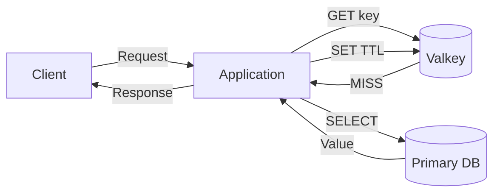

<div class="cover-content">
  <BrandLogo tone="dark" class="cover-logo" />

  <p class="eyebrow eyebrow--dark">A LIVE CAPABILITY DEMO</p>
  <h1>Valkey stories,<br><span>built in Slidev.</span></h1>
  <p class="cover-deck">Code, social proof, architecture diagrams, click-driven motion, and a cluster that scales in front of the audience.</p>

  <div class="cover-meta">
    <span>SHIKI</span><span>VUE</span><span>MERMAID</span><span>MOTION</span>
  </div>
</div>

<!--
This is a presentation where every slide demonstrates a Slidev capability.
The subject matter stays grounded in Valkey, especially cache-aside and cluster scale-out.
Use the arrow keys: several slides have meaningful click states.
-->

---
layout: default
class: foundation-slide
routeAlias: foundation
clicks: 3
---

<div class="deck-header deck-header--compact">
  <p class="eyebrow">ORIGIN · GOVERNANCE · COMMUNITY</p>
  <h1>Valkey started open—and is governed to stay open.</h1>
</div>

<FoundationPillars :step="$clicks" />

<SlideFooter />

<!--
Valkey continues the Redis OSS 7.2.4 codebase under neutral Linux Foundation governance.
The project is built by the community for the community.

Advance three times: origin, governance, then community.
Each tile rises into place and its contents cascade, so the pillar being discussed is the only new thing on screen.
-->

---
layout: default
class: participants-slide
routeAlias: participants
---

<div class="deck-header deck-header--compact">
  <p class="eyebrow">OPEN SOURCE · SHARED STEWARDSHIP</p>
  <h1>Valkey is built in the open—by a growing community.</h1>
  <p class="slide-lead">Twenty-one participating organizations contribute reach, expertise, services, and sustained investment.</p>
</div>

<ParticipantConstellation />

<p class="participant-source">Source: <a href="https://valkey.io/participants/">valkey.io/participants</a></p>

<SlideFooter />

<!--
The logos arrive from multiple directions when this slide is entered.
The roster and ordering reflect the current Valkey participants page.
-->

---
layout: default
class: capability-map-slide
routeAlias: capabilities
---

<div class="deck-header">
  <p class="eyebrow">THE DECK IS THE DEMO</p>
  <h1>One narrative. Many presentation primitives.</h1>
  <p class="slide-lead">Jump to any capability, or follow the story from code to topology.</p>
</div>

<div class="capability-grid">
  <Link to="click-builds" class="capability-card">
    <span>01</span><strong>Click builds</strong><small>Reveal only what the audience needs.</small>
  </Link>
  <Link to="code-focus" class="capability-card">
    <span>02</span><strong>Code focus</strong><small>Highlight different lines on each click.</small>
  </Link>
  <Link to="magic-move" class="capability-card">
    <span>03</span><strong>Magic Move</strong><small>Morph code as the design evolves.</small>
  </Link>
  <Link to="x-posts" class="capability-card">
    <span>04</span><strong>X posts</strong><small>Use live embeds or deterministic cards.</small>
  </Link>
  <Link to="cache-aside" class="capability-card">
    <span>05</span><strong>Animated diagrams</strong><small>Drive a cache-aside trace with clicks.</small>
  </Link>
  <Link to="scale-out" class="capability-card">
    <span>06</span><strong>Topology morph</strong><small>Scale nine nodes to twelve, then back.</small>
  </Link>
  <Link to="layout-gallery" class="capability-card">
    <span>07</span><strong>Layout gallery</strong><small>Tour all nineteen built-in canvases.</small>
  </Link>
  <Link to="diagrams" class="capability-card">
    <span>08</span><strong>Mermaid</strong><small>Render architecture directly from text.</small>
  </Link>
  <Link to="d3-architecture" class="capability-card">
    <span>09</span><strong>D3 architecture</strong><small>Build and animate a data-driven three-tier system.</small>
  </Link>
</div>

<SlideFooter />

<!--
These cards use Slidev's built-in Link component, so the agenda is interactive.
The deck also includes speaker notes, presenter view, and export-ready local assets.
-->

---
layout: default
class: click-build-slide
routeAlias: click-builds
clicks: 4
---

<div class="deck-header deck-header--compact">
  <p class="eyebrow">CLICK ANIMATIONS</p>
  <h1>Reveal the cache lifecycle at the pace of the story.</h1>
</div>

<div class="click-build-layout">
  <div class="reveal-sequence">
    <div class="reveal-row" v-click.fade.right="1">
      <span>01</span><strong>Request</strong><p>The application receives a product lookup.</p>
    </div>
    <div class="reveal-row" v-click.fade.right="2">
      <span>02</span><strong>Check</strong><p>Valkey is queried before the database.</p>
    </div>
    <div class="reveal-row reveal-row--accent" v-click.fade.right="3">
      <span>03</span><strong>Miss</strong><p>The application loads the source value.</p>
    </div>
    <div class="reveal-row" v-click.fade.right="4">
      <span>04</span><strong>Fill</strong><p>The value returns and the cache is refreshed.</p>
    </div>
  </div>

  <div class="click-api-card" v-motion :initial="{ x: 45, opacity: 0 }" :enter="{ x: 0, opacity: 1 }">
    <span class="api-label">SLIDEV API</span>
    <code>v-click.fade.right="1"</code>
    <code>v-click.fade.right="2"</code>
    <code>v-click.fade.right="3"</code>
    <code>v-click.fade.right="4"</code>
    <p>Absolute click positions keep parallel elements synchronized.</p>
  </div>
</div>

<SlideFooter />

<!--
Advance one row at a time.
The explicit click numbers make the sequence stable even if the slide is edited later.
The API card enters with v-motion when the slide itself appears.
-->

---
layout: default
class: code-focus-slide valkey-dark
routeAlias: code-focus
---

<div class="deck-header deck-header--compact">
  <p class="eyebrow eyebrow--dark">DYNAMIC LINE HIGHLIGHTING</p>
  <h1>Guide attention through real code.</h1>
</div>

```ts {2-3|5-7|9-10|12|all}{lines:true}
async function getProduct(id: string) {
  const key = `product:${id}`
  const cached = await cache.get(key)

  if (cached) {
    return JSON.parse(cached)
  }

  const product = await database.products.find(id)
  await cache.setEx(key, 300, JSON.stringify(product))

  return product
}
```

<div class="code-click-map">
  <span>1 · key + lookup</span><span>2 · cache hit</span><span>3 · miss + fill</span><span>4 · response</span>
</div>

<SlideFooter tone="dark" />

<!--
Each click moves the highlight: key lookup, cache hit, database fallback, then return.
The code does not change on this slide; only the audience's focus changes.
The adapter names are illustrative so the pattern remains client-library neutral.
-->

---
layout: default
class: magic-move-slide valkey-dark
routeAlias: magic-move
---

<div class="deck-header deck-header--compact">
  <p class="eyebrow eyebrow--dark">SHIKI MAGIC MOVE</p>
  <h1>Evolve the implementation without losing context.</h1>
</div>

````md magic-move {duration:550}
```ts
async function getProduct(id: string) {
  return database.products.find(id)
}
```

```ts
async function getProduct(id: string) {
  const key = `product:${id}`
  const cached = await cache.get(key)

  if (cached)
    return JSON.parse(cached)

  return database.products.find(id)
}
```

```ts
async function getProduct(id: string) {
  const key = `product:${id}`
  const cached = await cache.get(key)

  if (cached)
    return JSON.parse(cached)

  const product = await database.products.find(id)
  await cache.setEx(key, 300, JSON.stringify(product))
  return product
}
```
````

<p class="magic-caption">Database only <span>→</span> read-through check <span>→</span> complete cache-aside path</p>

<SlideFooter tone="dark" />

<!--
Click twice to morph the function.
Magic Move preserves line identity, so additions feel like an evolution rather than a hard cut.
The final state fills Valkey only after the source value has been loaded.
-->

---
layout: default
class: social-slide
routeAlias: x-posts
---

<div class="deck-header deck-header--compact">
  <p class="eyebrow">CUSTOM VUE + SOCIAL CONTENT</p>
  <h1>Bring X posts into the narrative.</h1>
</div>

<div class="social-grid">
  <XPost posted-at="10:24 AM · DEMO" :replies="31" :reposts="104" :likes="628" v-click.fade.right>
    <p>Valkey keeps the critical data path <strong>open</strong>: BSD licensed, Linux Foundation backed, and shaped by its community.</p>
  </XPost>

  <XPost posted-at="2:07 PM · DEMO" :replies="18" :reposts="73" :likes="391" v-click.fade.right>
    <p>Cache-aside in three verbs: <code>GET</code> → load → <code>SET + TTL</code>. Let misses refresh the hot path.</p>
  </XPost>
</div>

<div class="live-embed-strip" v-click>
  <code>&lt;Tweet url="https://x.com/.../status/..." /&gt;</code>
  <span>Slidev also supports live X embeds; these offline cards keep exports deterministic.</span>
</div>

<SlideFooter />

<!--
The cards are local Vue components, not claims that these exact posts exist on X.
They are explicitly marked OFFLINE DEMO.
For a live event with network access, replace either card with Slidev's built-in Tweet component.
-->

---
layout: default
class: mermaid-slide
routeAlias: diagrams
---

<div class="deck-header deck-header--compact">
  <p class="eyebrow">MERMAID · DIAGRAMS AS CODE</p>
  <h1>Turn architecture text into a rendered system map.</h1>
</div>



<div class="diagram-source-strip">
  <code>flowchart LR</code><span>Versionable · editable · themeable · exportable</span>
</div>

<SlideFooter />

<!--
This diagram is authored directly in the Markdown file as Mermaid.
It is ideal for architecture that should remain reviewable in source control.
The next slide turns the same model into a bespoke, step-by-step animation.
-->

---
layout: default
class: d3-architecture-slide
routeAlias: d3-architecture
clicks: 2
---

<div class="deck-header deck-header--compact">
  <p class="eyebrow">D3.JS · DATA-DRIVEN ARCHITECTURE</p>
  <h1>Three tiers separate experience, behavior, and state.</h1>
</div>

<ThreeTierArchitecture :step="$clicks" />

<p class="interaction-hint"><kbd>→</kbd> Reveal presentation, application, then data—with Valkey on the hot path.</p>

<SlideFooter />

<!--
Advance twice. D3 positions every tier, node, and connection and animates the transitions.
The final state shows Valkey beside the primary database and object storage in the data tier.
-->

---
layout: default
class: cache-aside-slide
routeAlias: cache-aside
clicks: 5
---

<div class="deck-header deck-header--compact">
  <p class="eyebrow">CLICK-DRIVEN CUSTOM DIAGRAM</p>
  <h1>Trace cache-aside one network hop at a time.</h1>
</div>

<CacheAsideDiagram :step="$clicks" />

<p class="interaction-hint"><kbd>→</kbd> Advance through GET, MISS, SELECT, VALUE, and SET + response.</p>

<SlideFooter />

<!--
Advance five times.
Every arrow is persistent once introduced; the current hop receives the strongest emphasis.
This is a custom Vue component driven by Slidev's global click count.
-->

---
layout: default
class: motion-slide valkey-indigo
routeAlias: motion
clicks: 2
---

<div class="deck-header deck-header--compact">
  <p class="eyebrow eyebrow--dark">@VUEUSE/MOTION</p>
  <h1>Move one carrier through multiple states.</h1>
</div>

<div class="motion-layout">
  <MotionTrack />

  <div class="motion-api">
    <span>CLICK VARIANTS</span>
    <code>:enter="{ x: 0 }"</code>
    <code>:click-1="{ x: 260 }"</code>
    <code>:click-2="{ x: 520 }"</code>
    <p>One element keeps visual continuity while its state changes.</p>
  </div>
</div>

<SlideFooter tone="dark" />

<!--
Advance twice to move the Valkey mark along the same track.
Unlike show/hide builds, motion variants preserve one carrier element across states.
This technique works well for packets, cursors, requests, or ownership changes.
-->

---
layout: default
class: cluster-slide valkey-indigo
routeAlias: scale-out
clicks: 2
---

<div class="deck-header deck-header--compact">
  <p class="eyebrow eyebrow--dark">CUSTOM MORPH · CLUSTER SCALE-OUT AND BACK</p>
  <h1>Three shards become four—then back to three.</h1>
</div>

<ClusterMorph :step="$clicks" />

<p class="cluster-caption"><span>Initial:</span> 3 shards × (1 primary + 2 replicas) = 9 nodes <b>→</b> <span>Scaled out:</span> 4 × 3 = 12 nodes <b>→</b> <span>Scaled in:</span> 3 × 3 = 9 nodes</p>

<SlideFooter tone="dark" />

<!--
Advance twice.
First click: the three shard groups morph to new positions and widths while shard four enters, and 41 slot blocks per primary migrate to it.
Second click: the same motion runs in reverse—the migrated slots return to their original primaries and shard four drains and retires, back to nine nodes.
Each shard has one primary and two replicas, and the slot ranges are recalculated for the current shard count.
-->

---
layout: default
class: addon-demo addon-animated-text-demo valkey-indigo
routeAlias: addon-animated-text
---

<div class="deck-header deck-header--compact">
  <p class="eyebrow eyebrow--dark">ADDON · ANIMATED TEXT</p>
  <h1>ANIMATED-TEXT · Draw emphasis one stroke at a time.</h1>
</div>

<div class="animated-text-layout">
  <div class="animated-text-stage">
    <span class="addon-stage-label">TEGAKI CANVAS</span>
    <animated-text text="Valkey stays open." font="caveat" :speed="1.15" />
  </div>

  <div class="addon-api-card addon-api-card--dark">
    <span>COMPONENT</span>
    <code>&lt;animated-text</code>
    <code>&nbsp; text="Valkey stays open."</code>
    <code>&nbsp; font="caveat"</code>
    <code>&nbsp; :speed="1.15" /&gt;</code>
    <p>Bundled fonts include Caveat, Italianno, Tangerine, and Parisienne.</p>
  </div>
</div>

<SlideFooter tone="dark" />

<!-- The animated-text addon renders the sentence once when the slide mounts. -->

---
layout: default
class: addon-demo addon-window-demo valkey-dark
routeAlias: addon-window-mockup
---

<div class="deck-header deck-header--compact">
  <p class="eyebrow eyebrow--dark">ADDON · WINDOW MOCKUP</p>
  <h1>WINDOW-MOCKUP · Put live content inside a familiar frame.</h1>
</div>

<div class="window-demo-layout">
  <WindowMockup dark>
    <div class="window-demo-terminal">
      <div><span class="terminal-prompt">$</span> valkey-cli</div>
      <div><span class="terminal-prompt">127.0.0.1:6379&gt;</span> SET launch:status ready</div>
      <div class="terminal-ok">OK</div>
      <div><span class="terminal-prompt">127.0.0.1:6379&gt;</span> GET launch:status</div>
      <div class="terminal-value">"ready"</div>
    </div>
  </WindowMockup>

  <div class="addon-api-card addon-api-card--dark">
    <span>COMPONENT</span>
    <code>&lt;WindowMockup dark&gt;</code>
    <code>&nbsp; ...content...</code>
    <code>&lt;/WindowMockup&gt;</code>
    <p>The addon also supports a <code>shell window</code> code-fence modifier.</p>
  </div>
</div>

<SlideFooter tone="dark" />

<!-- WindowMockup can wrap arbitrary Vue or Markdown content in light or dark chrome. -->

---
layout: default
class: addon-demo addon-stem-demo
routeAlias: addon-stem
---

<div class="deck-header deck-header--compact">
  <p class="eyebrow">ADDON · STEM</p>
  <h1>STEM · Pair technical figures with durable captions.</h1>
</div>

<div class="stem-demo-layout">
  <div class="stem-demo-copy">
    <span class="addon-stage-label">IMAGEFIGURE COMPONENT</span>
    <h2>One figure, one interpretation.</h2>
    <p>The STEM addon keeps scientific and architectural visuals tied to a caption that survives presentation and export.</p>
    <code>&lt;ImageFigure src="/layout-demo.svg" ... /&gt;</code>
  </div>

  <ImageFigure
    src="/layout-demo.svg"
    caption="Figure 1 · Valkey workload paths: cache, queue, and primary data"
    width="100%"
    height="300px"
  />
</div>

<SlideFooter />

<!-- STEM also provides interactive PlotlyFigure and the figure-side layout. -->

---
layout: section
class: layout-gallery layout-section-demo
routeAlias: layout-gallery
---

<p class="layout-chip layout-chip--dark">SECTION</p>

# Built-in layout gallery

<p class="layout-subtitle">Nineteen canvases for nineteen different storytelling jobs.</p>

<div class="layout-progress">01 / 19</div>

<!-- The section layout marks a major transition in the presentation. -->

---
layout: center
class: layout-gallery layout-center-demo
---

<div class="layout-center-content">
  <p class="layout-chip">CENTER</p>
  <BrandLogo compact />
  <h1>One idea.<br>Exactly centered.</h1>
  <p>Use this layout for a pause, a reset, or a single focal point.</p>
</div>

<div class="layout-progress">02 / 19</div>

---
layout: cover
class: layout-gallery layout-cover-demo
---

<div class="layout-cover-content">
  <BrandLogo tone="dark" />
  <p class="layout-chip layout-chip--dark">COVER</p>
  <h1>Open the story<br>with a clear promise.</h1>
  <p>Title, context, and visual identity in one frame.</p>
</div>

<div class="layout-progress layout-progress--dark">03 / 19</div>

---
layout: default
class: layout-gallery layout-default-demo
---

<p class="layout-chip">DEFAULT</p>

# The flexible everyday canvas

<div class="layout-default-grid">
  <article><span>01</span><strong>Title</strong><p>Make the assertion clear.</p></article>
  <article><span>02</span><strong>Evidence</strong><p>Add only what supports it.</p></article>
  <article><span>03</span><strong>Action</strong><p>Land the next decision.</p></article>
</div>

<SlideFooter />
<div class="layout-progress">04 / 19</div>

---
layout: intro
class: layout-gallery layout-intro-demo
---

<p class="layout-chip">INTRO</p>

# Valkey layout laboratory

A guided tour of Slidev's built-in presentation canvases.

<div class="layout-author">
  <BrandLogo compact />
  <span>Valkey Community<br><small>Open source · technical · composable</small></span>
</div>

<div class="layout-progress">05 / 19</div>

---
layout: fact
class: layout-gallery layout-fact-demo
---

<p class="layout-chip">FACT</p>

# 19

Built-in layouts in Slidev core

<div class="layout-progress">06 / 19</div>

---
layout: statement
class: layout-gallery layout-statement-demo
---

<p class="layout-chip">STATEMENT</p>

# Layout is a narrative decision.

<div class="statement-rule" />
<p>Choose the canvas that makes the idea easiest to understand.</p>

<div class="layout-progress">07 / 19</div>

---
layout: quote
class: layout-gallery layout-quote-demo
---

<p class="layout-chip">QUOTE</p>

# “The slide deck is executable.”

### — This Valkey capability demo

<div class="layout-progress">08 / 19</div>

---
layout: full
class: layout-gallery layout-full-demo
---

<div class="full-demo-canvas">
  <header><span class="layout-chip layout-chip--dark">FULL</span><strong>Use every pixel</strong><code>1200 × 675</code></header>
  <div class="full-demo-grid">
    <article><code>GET</code><strong>product:42</strong><span>cache hit</span></article>
    <article><code>TTL</code><strong>284</strong><span>seconds</span></article>
    <article><code>SHARDS</code><strong>4</strong><span>healthy</span></article>
    <article><code>NODES</code><strong>12</strong><span>available</span></article>
  </div>
</div>

<div class="layout-progress layout-progress--dark">09 / 19</div>

---
layout: none
class: layout-gallery layout-none-demo
---

<div class="none-demo-canvas">
  <div class="none-demo-number">10</div>
  <div class="none-demo-copy">
    <p class="layout-chip layout-chip--dark">NONE</p>
    <h1>No inherited composition.</h1>
    <p>Start from an empty canvas and own every coordinate.</p>
  </div>
  <BrandLogo compact tone="dark" />
</div>

<div class="layout-progress layout-progress--dark">10 / 19</div>

---
layout: two-cols
class: layout-gallery layout-two-cols-demo
---

<p class="layout-chip">TWO-COLS</p>

# Implementation

```shell
valkey-cli GET product:42
```

<p class="column-caption">Code, commands, or evidence live naturally on the left.</p>

::right::

# Interpretation

<div class="column-insight">
  <span>HIT</span>
  <strong>The value returns from memory.</strong>
  <p>Pair an artifact with the meaning the audience should take from it.</p>
</div>

<SlideFooter />
<div class="layout-progress">11 / 19</div>

---
layout: two-cols-header
class: layout-gallery layout-two-cols-header-demo
---

<p class="layout-chip">TWO-COLS-HEADER</p>

# One assertion across two supporting views

::left::

## Before

<div class="comparison-panel comparison-panel--before"><strong>3 shards</strong><span>9 nodes</span></div>

::right::

## After

<div class="comparison-panel comparison-panel--after"><strong>4 shards</strong><span>12 nodes</span></div>

<SlideFooter />
<div class="layout-progress">12 / 19</div>

---
layout: image
image: /layout-demo.svg
backgroundSize: cover
class: layout-gallery layout-image-demo
---

<div class="layout-float-label layout-float-label--dark"><strong>Full-frame visual</strong><span>The visual is the slide.</span></div>
<div class="layout-progress layout-progress--dark">13 / 19</div>

---
layout: image-left
image: /layout-demo.svg
backgroundSize: cover
class: layout-gallery layout-image-left-demo
---

<p class="layout-chip">IMAGE-LEFT</p>

# Visual first.

The image occupies the left half while explanation remains readable on the right.

<div class="layout-mini-list"><span>Photography</span><span>Product UI</span><span>Architecture</span></div>

<div class="layout-progress">14 / 19</div>

---
layout: image-right
image: /layout-demo.svg
backgroundSize: cover
class: layout-gallery layout-image-right-demo
---

<p class="layout-chip">IMAGE-RIGHT</p>

# Context first.

Lead with the assertion, then let the visual complete it on the right.

<div class="layout-mini-list"><span>Claim</span><span>Evidence</span><span>Result</span></div>

<div class="layout-progress">15 / 19</div>

---
layout: iframe
url: /layout-demo.html
class: layout-gallery layout-iframe-demo
---

<div class="layout-float-label layout-float-label--dark"><strong>IFRAME</strong><span>A complete local web page fills the frame.</span></div>
<div class="layout-progress layout-progress--dark">16 / 19</div>

---
layout: iframe-left
url: /layout-demo.html
class: layout-gallery layout-iframe-left-demo
---

<p class="layout-chip">IFRAME-LEFT</p>

# Live surface, guided explanation.

The embedded page stays active on the left while narration and decisions live here.

<div class="layout-callout">Local fixture · deterministic export · no network dependency</div>

<div class="layout-progress">17 / 19</div>

---
layout: iframe-right
url: /layout-demo.html
class: layout-gallery layout-iframe-right-demo
---

<p class="layout-chip">IFRAME-RIGHT</p>

# Explain, then demonstrate.

Use the left column for setup and the embedded page on the right for proof.

<div class="layout-callout">Great for product tours, dashboards, and runnable demos.</div>

<div class="layout-progress">18 / 19</div>

---
layout: end
class: layout-gallery layout-end-demo
---

<p class="layout-chip layout-chip--dark">END</p>

# The built-in final frame.

Thanks for touring every Slidev layout.

<div class="layout-end-links"><Link to="capabilities">Back to capabilities</Link><Link to="end">Continue to close</Link></div>
<div class="layout-progress layout-progress--dark">19 / 19</div>

<!-- End is a purpose-built closing layout; the deck's branded cover follows as the final bookend. -->

---
layout: cover
class: valkey-demo-end
routeAlias: end
---

<div class="end-content">
  <BrandLogo tone="dark" class="end-logo" />
  <p class="eyebrow eyebrow--dark">MARKDOWN · VUE · OPEN WEB</p>
  <h1>The slide deck<br><span>is executable.</span></h1>
  <p>Present it. Inspect it. Fork it. Export it.</p>

  <div class="end-links">
    <a href="https://valkey.io">valkey.io</a>
    <a href="https://sli.dev">sli.dev</a>
  </div>
</div>

<div class="end-mark"><BrandLogo compact tone="dark" /></div>

<!--
Close on the core idea: Slidev makes the presentation itself part of the technical artifact.
The deck is local-first, source-controlled, and built from the same open web primitives it demonstrates.
-->
